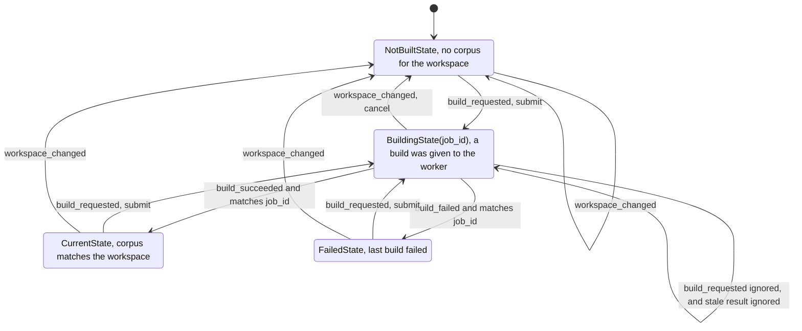

# M5 Design

1. M4 Fixes
- Reworked read_exact function in IPCServer, originally it woke every 50 ms to check running_ which is polling. Now it waits in poll() on the client and the listen socket with a 5s client deadline and IPCServer::stop shuts down the listen socket which wakes poll() immediately
- DelayingChunker would sleep in 10 ms while checking the atomic flag, now it waits in CancelToken::wait_for which is a condition variable that the CancelToken::cancel() function wakes
- Replaced CorpusBuilder with BuildWorker

2. Threads

The GUi thread: MainWindow, widgets, CorpusState, BuildWorker submit, cancel and stop functions, and IPCServer start and stop functions

Build thread: BuildWorker::run gets started in the constructor, and is joined in BuildWorker::stop() from MainWindow's destructor. Builds using workspace copy.
IPC Thread: started with IPCServer::start and joined in IPCServer::stop()

BuildWorker shared data is pending_, running_, and stopping_. They are protected by the mutex_ and wake_, they are alwasy accessed under the mutex and the worker waits with
wake_.wait(). They are used by GUI thread in submit, cancel, and stop and by the build thread in run.

CancelToken::cancelled_ is shared and also protected by the token's mutex_ and condition variable, the lock order is always the BuildWorker::mutex_ first then the token's so there is no deadlock. Set by GUI thread through BuildWorker, read by the build thread in the chunk function.

IPCServer::running_ is shared and its type std::atomic protects it from read and writes. Written by the GUI thread in stop and read by the IPC thread in run

A finished BuildResult is moved into a shared ptr and posted to the GUI thread with a queued invokeMethod Qt function, after this the worker doesn't touch it. Same for remote adds.

3. States

The states were reworked from the enum class to just classes that inherit from a base CorpusState class. MainWindow holds a unique pointer with type CorpusState called state_ and passes events to it. The states are NotBuiltState, BuildingState, CurrentState, and FailedState, same as the enum class. Each state has it's own function logic that handle what to do when a build is request, the workspace is changed, or when a build succeeds or fails.

Exiting is the same in every state, MainWindow destructor calls BuildWorker::stop() so no state handles it.

For the table I have an image in the root directory in case the mermaid block doesn't render properly. I used mermaid syntax and mermaid.live to render the diagram.

Here's the text that I typed to make the diagram:

4. Reset during a long build

On the gui side build_corpus() is called -> NotBuiltState::build_requested -> start_build
-> BuildWorker::submit this sets pending_ and notifies wake_ and the state changes to BuildingState(1) (the 1 is the job id). Now on the build thread run wakes and moves the request from pending, sets running_ to a new token, unlocks, then DelayingChunker::chunk waits in CancelToken::wait_for. On the gui side reset_application is called which means the workspace changed so the build cancels -> BuildingState::workspace_changed -> cancel_build -> BuildWorker::cancel, this clears pending and cancel_running_locked -> CancelToken::cancel then the state becomes NotBuiltState. On the build thread wait_for returns immediately, BuildCancelled ends the build, run clears running_, skips on_finished because the token was cancelled, and waits on wake_. The gui is ready for another build submit.

5. Decisions
When the user requests a build while one is running it is not allowed. While building BuildingState::can_build() returns false so Build Corpus is disabled and BuildingStete::build_requested ignores any requests. After a document is added or the workspace is reset the build is cancelled which makes Build Corpus available again and a new request can be submitted and started. The reason for this is because there's no point in having a stale build continue to run if the workspace has changed, and there's also no point in starting a build if a build is already running for the current workspace. This also applies to a remote addition, this also cancels the build and makes Build Corpus available again.
IPCServer::handle_client queues add_document_file on the gui thread which calls state_->workspace_changed() like add document does, so BuildingState::workspace_changed cancels the build and the user sees "Corpus: Not built" until they build again.

The shared data is pending_ which is the request, stopping_ which is the stop flag, and running_ and cancelled_ which are the running build's token. This is because the GUI needs to give the request, stop the worker and cancel a running build. Each of these are things that both threads need to be able to see. 

6. Fault Switches
AIWS_FAULT_NO_CANCEL is in BuildWorker::cancel_running_locked() and skips the cancel so an old build runs until its finished and the next build waits. This is caught by these tests:

test_worker_outdated_request_never_built
test_worker_cancel_does_not_delay_next_build
test_rebuild_after_reset_does_not_wait
test_rebuild_after_add_does_not_wait
test_rebuild_after_remote_add_does_not_wait

AIWS_FAULT_SILENT_SHUTDOWN is in BuildWorker::stop() and skips wake_.notify_one() so an idle worker never wakes and join() hangs. This caught by these tests:

test_worker_exit_when_idle
test_window_exit_when_idle

7. AI USE
I used Claude for outlining functions, planning, writing tests, and updating CMakeLists.txt. 
Check AI_LOG.md